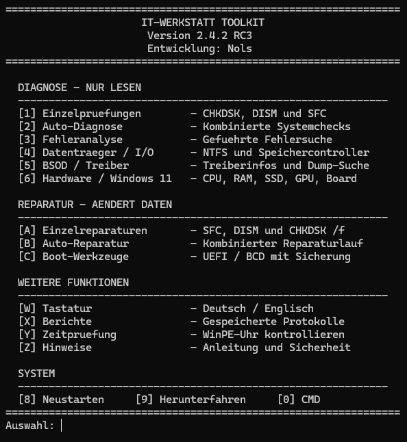
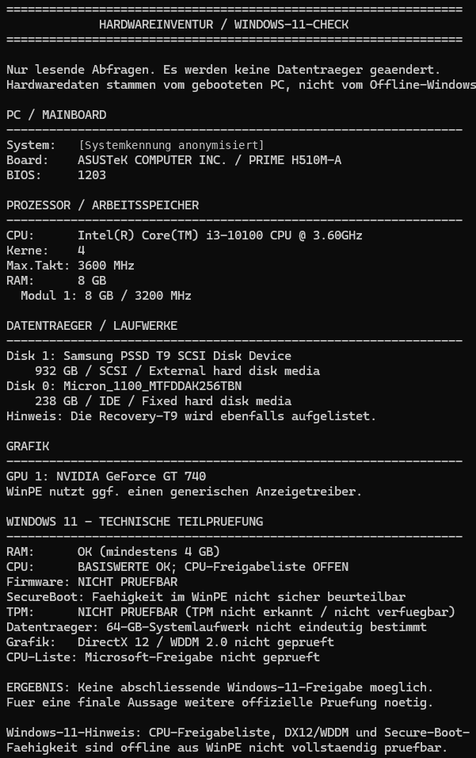
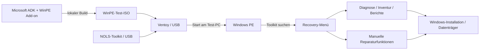
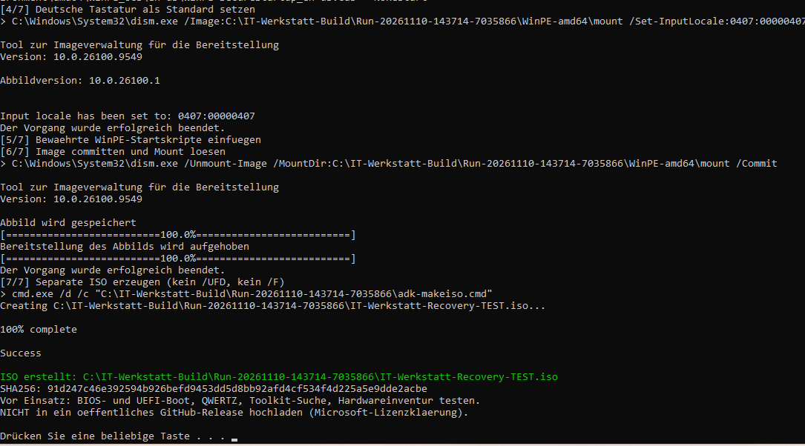

# IT-Werkstatt Toolkit

[](https://github.com/Nols983/IT-Werkstatt-Toolkit-Portfolio/actions/workflows/validate.yml)

**Windows-Recovery und Offline-Diagnose für den Werkstatteinsatz.**

Das IT-Werkstatt Toolkit ist ein persönliches Praxisprojekt zur Fehlersuche an Windows-Rechnern. Es bündelt Diagnoseabläufe, Hardwareinformationen und ausgewählte Reparaturfunktionen in einer konsolenbasierten Oberfläche. Das Ziel ist nicht, möglichst viele Einzelprogramme zu sammeln, sondern wiederkehrende Prüfungen nachvollziehbar und mit möglichst wenig manuellen Zwischenschritten durchzuführen.

Ich entwickle das Toolkit anhand von Aufgaben aus dem Werkstattalltag. Besonders wichtig sind mir die saubere Trennung von Diagnose und Reparatur, der Schutz angeschlossener Datenträger und die Möglichkeit, auch bei einem nicht mehr startenden Windows zu arbeiten.

## Downloads

Im [Release **v2.4.2-rc3**](https://github.com/Nols983/IT-Werkstatt-Toolkit-Portfolio/releases/tag/v2.4.2-rc3) stehen zwei gebrauchsfertige ZIP-Pakete bereit:

- **`IT-Werkstatt-Toolkit-v2.4.2-RC3.zip`:** Recovery-Menue mit Modulen und Dokumentation. Den enthaltenen Ordner `NOLS-Toolkit` direkt in das Stammverzeichnis der Ventoy-Datenpartition entpacken.
- **`IT-Werkstatt-WinPE-Builder-v0.2.4.zip`:** WinPE-Builder v0.2.4 mit Startskripten. Damit laesst sich auf einem Windows-PC mit Microsoft ADK und WinPE-Add-on eine eigene Test-ISO erstellen.

**Nicht enthalten:** eine fertige WinPE-ISO, Microsoft-WinPE-Binaerdateien, Drittanbieterprogramme oder Kundendaten. Die Recovery-Funktionen setzen eine geeignete Windows-PE-Umgebung voraus. Dieser Stand ist eine Preview und keine universell getestete Reparaturloesung.

## Einblick in die Recovery-Umgebung

Die Recovery-Umgebung wird aus dem Microsoft ADK lokal erstellt und über Ventoy gestartet. Das Toolkit liegt unabhängig von der ISO auf dem USB-Datenträger. Dadurch können die Diagnosemodule aktualisiert werden, ohne für jede Änderung eine neue WinPE-ISO bauen zu müssen.



*Hauptmenü des Recovery-Toolkits, direkt unter Windows aufgenommen. Der Start über WinPE und Ventoy wurde gesondert getestet.*

### Hardwareinventur

Die Hardwareinventur wurde auf einem Test-PC sowohl unter Windows als auch unter WinPE ausgeführt. Die folgende Aufnahme stammt aus **Windows**; die individuelle Systemkennung ist für die Veröffentlichung anonymisiert.



Die Windows-11-Prüfung ist keine offizielle Kompatibilitätsfreigabe. Der TPM-Status konnte in dieser Windows-Aufnahme nicht bestimmt werden; bei einem separaten WinPE-Test wurde TPM 2.0 gemeldet. Grafikdaten können in WinPE fehlen.

## Was das Projekt abdeckt

- **Systemdiagnose:** Offline-Laufwerkserkennung sowie Prüfpfade für SFC, DISM und CHKDSK.
- **Boot und UEFI:** Untersuchung von Startkonfiguration und EFI-Systempartition; getrennte, bewusst aufrufbare Reparaturfunktionen.
- **Fehleranalyse:** Auswertung verfügbarer Protokolle, Suche nach Dump-Dateien und Aufbereitung von Diagnoseergebnissen.
- **Hardwareinventur:** CPU, RAM, Mainboard, BIOS, Datenträger und TPM über WMI und Windows Script Host, soweit in der jeweiligen Umgebung verfügbar.
- **WinPE-Build:** Lokale ISO-Erstellung mit WMI-, Scripting- und SecureStartup-Komponenten sowie deutschem Tastaturlayout.

Neben dem Recovery-Menü enthält das Repository ältere Windows-Launcher-Dateien. Deren Verweise auf externe Programme sind kein vollständiges Software-Bundle; die Drittanbieterprogramme werden nicht mitgeliefert.

## Architektur



Der WinPE-Builder und die Diagnosemodule sind bewusst getrennt. Der Builder benötigt einen Windows-PC mit ADK; zum Starten der fertigen Recovery-Umgebung ist keine laufende Windows-Installation auf dem Zielgerät erforderlich.

Die internen Pfade unter `NOLS-Toolkit/` bleiben aus Kompatibilitätsgründen erhalten. Die Architektur ist in [`docs/ARCHITEKTUR.md`](docs/ARCHITEKTUR.md) beschrieben.

## Technologien

| Bereich | Umsetzung |
| --- | --- |
| Recovery-Umgebung | Windows PE, Microsoft ADK, WinPE-Add-on |
| Bootmedium | Ventoy |
| Menüs und Diagnosemodule | CMD / Batch |
| ISO-Build | PowerShell, DISM, ADK-Werkzeuge |
| Hardwareabfragen | VBScript, Windows Script Host, WMI |
| Offline-Auswertung und Tests | Python 3 |
| Versionsverwaltung und CI | Git, GitHub Actions |

## Aufbau und Nutzung

Für einen lokalen Test werden Windows mit Administratorrechten, das passende Windows ADK und das WinPE-Add-on benötigt. Die Ventoy-Installation auf dem USB-Medium muss bereits vorhanden sein.

### 1. Repository auschecken

```bash
git clone https://github.com/Nols983/IT-Werkstatt-Toolkit-Portfolio.git
cd IT-Werkstatt-Toolkit-Portfolio
```

### 2. WinPE-ISO auf Windows erstellen

In einer administrativen Eingabeaufforderung:

```cmd
cd winpe\builder
BUILD-RECOVERY.cmd --check
BUILD-RECOVERY.cmd --build
```

Der Builder legt einen eigenen Build-Ordner mit Test-ISO und SHA-256-Prüfsumme an. Er überschreibt keine vorhandene Recovery-ISO und beschreibt keinen USB-Datenträger.

#### WinPE-Builder im Praxistest

Der folgende Screenshot zeigt den erfolgreichen lokalen ISO-Build mit dem Microsoft ADK. Er ist ein Build-Nachweis, kein Screenshot des WinPE-Desktops.



*Die ISO wird lokal erzeugt und nicht als Download weitergegeben.*

### 3. Recovery-Medium vorbereiten

- `toolkit/NOLS-Toolkit/` als Ordner `NOLS-Toolkit/` in das Stammverzeichnis der Ventoy-Datenpartition kopieren.
- Die selbst erstellte WinPE-ISO separat auf die Ventoy-Partition kopieren.
- Am Test-PC die ISO über Ventoy starten. Der Autostart sucht nach `NOLS-Toolkit/START-RECOVERY.cmd`.

Weitere Details: [`docs/INSTALLATION.md`](docs/INSTALLATION.md) und [`winpe/builder/README.md`](winpe/builder/README.md).

## Validierung

**Stand: 10.11.2026.** Die folgenden Ergebnisse stammen aus konkreten Tests, nicht aus einer allgemeinen Freigabe für beliebige Hardware.

| Prüfung | Ergebnis |
| --- | --- |
| WinPE-Builder v0.2.4 mit ADK | Alle sieben Build-Phasen erfolgreich |
| Lokal gebaute ISO über Ventoy | Erfolgreich auf einem Test-PC gestartet |
| Recovery-Menü und Tastaturlayout | Auf Test-PC geprüft |
| Hardwareinventur unter Windows und WinPE | CPU, RAM, Mainboard/BIOS und Datenträger ausgelesen; TPM 2.0 im WinPE-Test gemeldet |
| Repository- und Builder-Regressionstests | 17 Tests unter Ubuntu bestanden |
| Grafikkarte unter WinPE | Auf dem Test-PC nicht auslesbar |
| Vollständige Minidump-Analyse mit WinDbg/CDB | Noch nicht umgesetzt |

Die GitHub-Action prüft Repository-Struktur und Quellcode. Sie erstellt keine WinPE-ISO und ersetzt keinen Boot-Test. Ein ausführlicher Teststand steht in [`docs/TESTSTATUS.md`](docs/TESTSTATUS.md).

Tests lokal ausführen:

```bash
python3 scripts/check_repository.py
python3 -m unittest discover -s tests -v
```

## Sicherheitskonzept und Grenzen

Diagnose und Reparatur sind im Toolkit getrennte Wege. Funktionen mit Schreibzugriff dürfen erst nach Prüfung des Zieldatenträgers, des BitLocker-Status und vorhandener Backups verwendet werden. Der vorhandene USB-Schutz basiert teilweise auf textueller DiskPart-Auswertung und ist nicht für sämtliche Hardware- und Sprachvarianten nachgewiesen.

Die Hardwareinventur hängt von den in WinPE verfügbaren WMI-Providern ab. Der Windows-11-Check liefert technische Hinweise, aber keine vollständige Kompatibilitätsfreigabe.

Dieses Repository enthält **keine fertige Microsoft-WinPE-ISO**, keine `boot.wim`, keine Drittanbieterprogramme und keine Kunden- oder Diagnoseprotokolle. Die Weitergabe von Microsoft-Komponenten ist von der lokalen ISO-Erstellung zu unterscheiden und unterliegt deren Lizenzbedingungen.

Siehe [`docs/SICHERHEIT-UND-FREIGABE.md`](docs/SICHERHEIT-UND-FREIGABE.md) und [`docs/LIZENZ-UND-WINPE.md`](docs/LIZENZ-UND-WINPE.md).

## Repository-Struktur

```text
toolkit/NOLS-Toolkit/    Recovery-Menü, Module und ergänzende Windows-Launcher
winpe/builder/           ADK-basierter Builder und WinPE-Startskripte
scripts/                 Prüf- und Hilfsskripte
tests/                   Repository- und Builder-Regressionstests
docs/                    Installation, Architektur, Teststand, Sicherheit
.github/workflows/       Statische Repository-Prüfungen
```

## Weiterentwicklung

Geplant sind eine einheitlichere Zusammenfassung der Diagnoseergebnisse, zusätzliche Datenträgerprüfungen und die spätere inhaltliche Analyse realer BSOD-Minidumps. Weitere Tests auf unterschiedlichen BIOS-/UEFI-Systemen sind ebenfalls vorgesehen.

Aktuell ist das Projekt ein **getesteter Entwicklungsstand**, kein allgemeines Produktrelease.

## Lizenz

Für den eigenen Quellcode ist derzeit keine Open-Source-Lizenz hinterlegt. Eine öffentliche Einsicht in das Repository bedeutet daher nicht automatisch eine Erlaubnis zur Weiterverwendung oder Weiterverbreitung. Für Microsoft WinPE und andere externe Komponenten gelten deren jeweilige Bedingungen.
